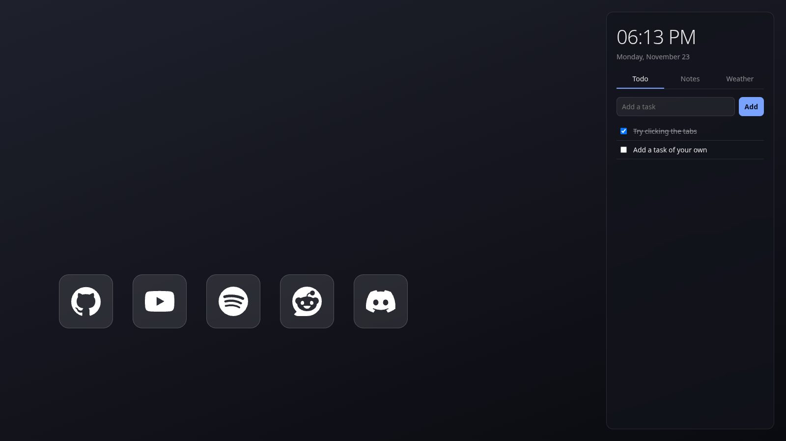
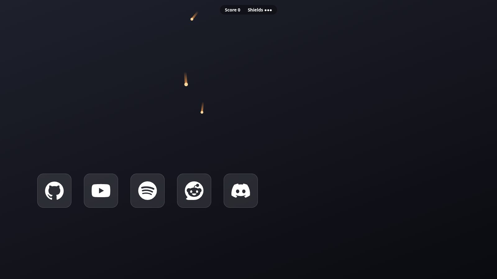
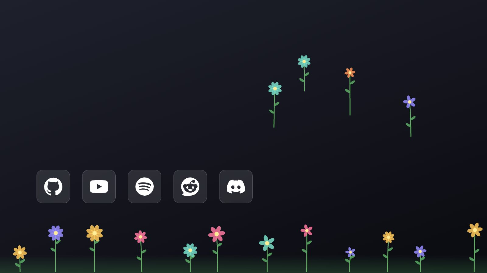
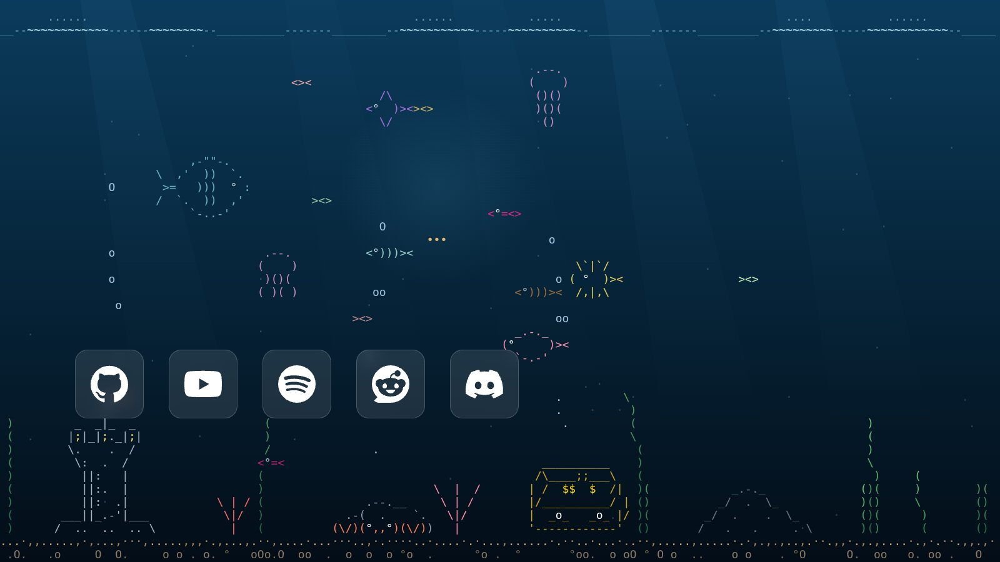
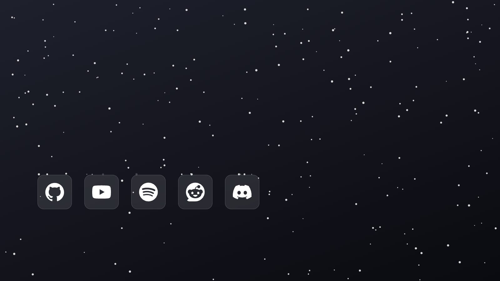
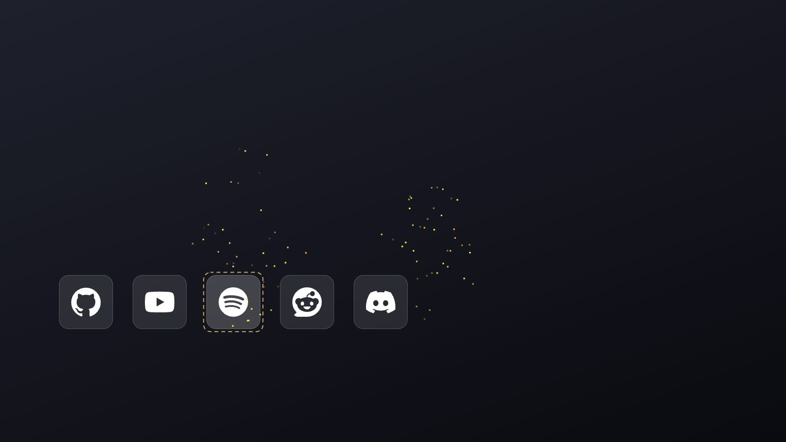
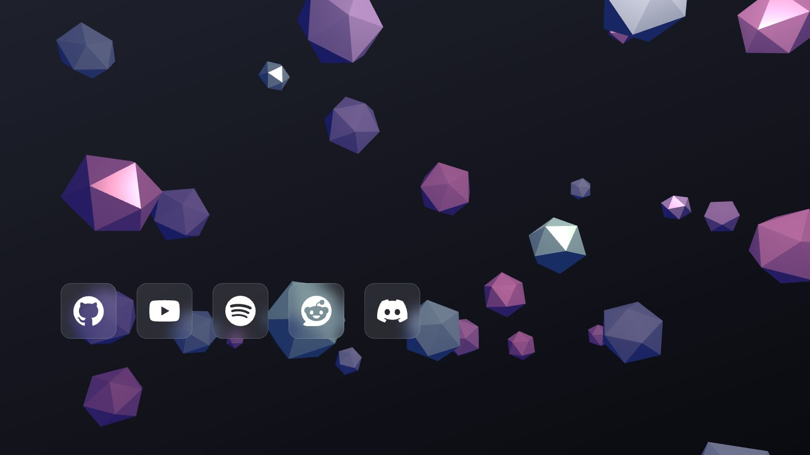

# Custom HTML background examples

Background layers written as a regular HTML page: canvas, CSS, SVG, or a
library like Three.js or p5.js.

## How to install

Download a file, then Settings → **Background** → **Open file…**. The layer
stays linked to the file and reloads whenever you save it, so you can keep
editing it (or have an LLM edit it) while watching the canvas. You can also
add an **HTML** layer and paste the content into its editor.

**Placement** chooses whether the layer draws behind or over the icons.

## Examples

| File                  |                                                                          | Placement  |
| --------------------- | ------------------------------------------------------------------------ | ---------- |
| `start-page.html`     | A start page docked on the right: clock, tabs, todo list, notes, weather |            |
| `meteor-defense.html` | A game: meteors aim at your icons, click to blast them                   |            |
| `garden.html`         | Flowers that lean away from the pointer; click to plant more             |            |
| `aquarium.html`       | A detailed ASCII fish tank; click to feed the fish                       |            |
| `snow.html`           | Snow that settles on the icons                                           | Over icons |
| `icon-sparks.html`    | Sparks around the hovered and clicked icons                              | Over icons |
| `three-scene.html`    | Three.js crystals, loaded from a CDN                                     |            |

## Screenshots

<table>
<tr><td align="center"><br><code>start-page.html</code></td><td align="center"><br><code>meteor-defense.html</code></td></tr>
<tr><td align="center"><br><code>garden.html</code></td><td align="center"><br><code>aquarium.html</code></td></tr>
<tr><td align="center"><br><code>snow.html</code></td><td align="center"><br><code>icon-sparks.html</code></td></tr>
<tr><td align="center"><br><code>three-scene.html</code></td></tr>
</table>

## How it runs

- The page runs in a sandboxed frame. It also gets the pointer and icons
  through `odeko` (below), even under the icons and when not interactive.
- Layers behind the icons are **Interactive** by default: the page takes
  clicks, hover, scrolling and typing wherever no icon covers it, like a
  normal web page. Icons stay on top and clickable, and edit mode turns it
  off while you arrange them. Turn it off for pure wallpapers. The page has
  no storage, so its state resets when it reloads; use a Custom HTML widget
  when you need `odeko.storage`.
- **Run JavaScript** can be turned off per layer; the page then renders as
  static HTML/CSS. Layers from an imported preset or layer file start with it
  off.
- `<script src="https://…">`, `import … from "https://…"` and import maps
  load libraries through a local cache: they download on first use and work
  offline afterwards.
- Direct `fetch` is blocked. `odeko.fetch(url)` asks you once per host, like
  Custom HTML widgets.

## The `odeko` helper

```js
odeko.on('frame', (state) => {
	// called every frame while the canvas is shown
});
odeko.on('pause', () => {}); // canvas hidden: stop your own loops
odeko.on('resume', () => {});
const { status, body } = await odeko.fetch('https://api.example.com/data');
```

`state` (CSS pixels, origin top-left of the layer):

| Field      |                                                                       |
| ---------- | --------------------------------------------------------------------- |
| `time`     | seconds the layer has been running                                    |
| `width`    | layer size                                                            |
| `height`   |                                                                       |
| `pointer`  | `{ x, y, presence }`, presence fades 0–1 as the pointer enters/leaves |
| `velocity` | `{ x, y }` pointer velocity in pixels per second                      |
| `hover`    | `{ x, y, width, height, amount }` last hovered icon, amount 0–1       |
| `icons`    | `[{ x, y, width, height }]` every icon                                |
| `clicks`   | `[{ x, y, age }]` last 8 clicks, newest first, age in seconds         |
| `pulse`    | `{ x, y, age }` last icon click                                       |

`odeko.state` holds the latest one and `odeko.paused` whether the canvas is
hidden.

## Generating one with an LLM

Paste this README into the chat and describe the effect.
