# Custom HTML widget examples

A Custom HTML widget is a normal web page: HTML, CSS and JavaScript, with no
special quoting rules. It runs in a sandboxed frame and gets a small `odeko`
helper for saved data and network access.

## How to install

1. Enter edit mode (F2) → **Add Widget** → **Custom HTML**.
2. Right-click the widget → **Open Settings…** → **Page** tab.
3. Either paste a file's content into the editor, or press **Load from
   file…** to link the file. A linked file reloads whenever you save it, so
   you can keep editing it (or have an LLM edit it) while watching the canvas.
4. **Save Changes**.

## Examples

Start with `command-deck.html` to see what a widget can do. The rest are small
and focused, so they are easy to copy from.

Clocks, weather, tasks and notes are built-in widgets already; these cover
what the built-ins don't.

**Showcase**

| File                | What it is                                                                         | Uses                   |
| ------------------- | ---------------------------------------------------------------------------------- | ---------------------- |
| `command-deck.html` | Weather chart (Chart.js from a CDN), focus timer, Hacker News, notes; keys 1–4 tab | `odeko.fetch`, storage |

**Everyday**

| File                 | What it is                                                              | Uses            |
| -------------------- | ----------------------------------------------------------------------- | --------------- |
| `calendar.html`      | Month view with today highlighted; arrows or the wheel change the month |                 |
| `pomodoro.html`      | 25/5 minute timer that keeps running across restarts                    | `odeko.storage` |
| `countdown.html`     | Days until an event; click to set the name and date                     | `odeko.storage` |
| `habit-tracker.html` | Three weeks of habits as a grid of squares, with streaks                | `odeko.storage` |

**Online data**

| File                    | What it is                                                         | Uses                   |
| ----------------------- | ------------------------------------------------------------------ | ---------------------- |
| `rss-reader.html`       | Latest items of any RSS or Atom feed; click the title to change it | `odeko.fetch`, storage |
| `github-activity.html`  | Stars, forks, issues and recent commits of a repository            | `odeko.fetch` headers  |
| `crypto-ticker.html`    | BTC/ETH price and 24h change, refreshing every 30s (CoinGecko)     | `odeko.fetch`          |
| `image-of-the-day.html` | NASA's Astronomy Picture of the Day                                | `odeko.fetch`, storage |

**Fun**

| File                 | What it is                                                                            | Uses                          |
| -------------------- | ------------------------------------------------------------------------------------- | ----------------------------- |
| `ambient-mixer.html` | Rain, wind, waves and hum generated with Web Audio; silent while the canvas is hidden | storage, pause/resume         |
| `game-2048.html`     | 2048 with arrow keys or swipes; the game is saved                                     | `odeko.storage`               |
| `tamagotchi.html`    | An egg-shaped pocket pet that hatches and grows in real time; feed, play, clean       | `odeko.storage`, pause/resume |

## Screenshots

<table>
<tr><td align="center">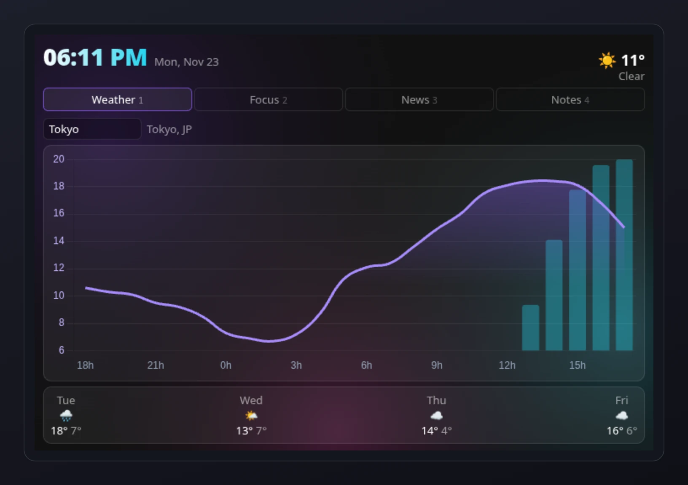<br><code>command-deck.html</code></td><td align="center">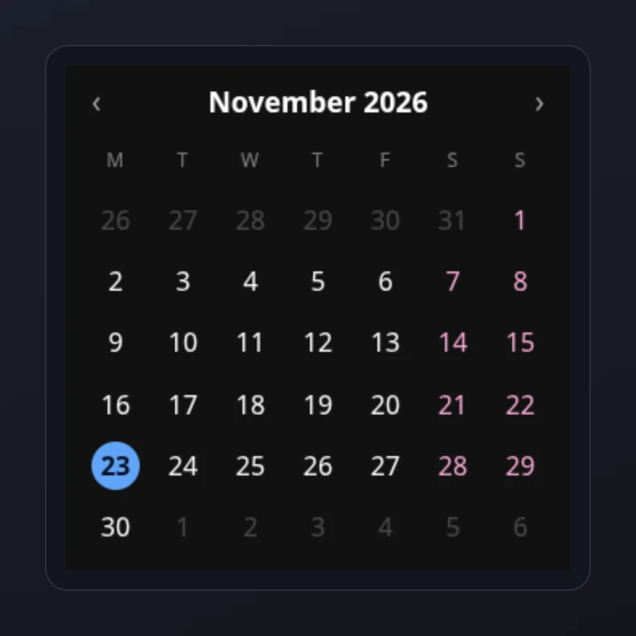<br><code>calendar.html</code></td><td align="center">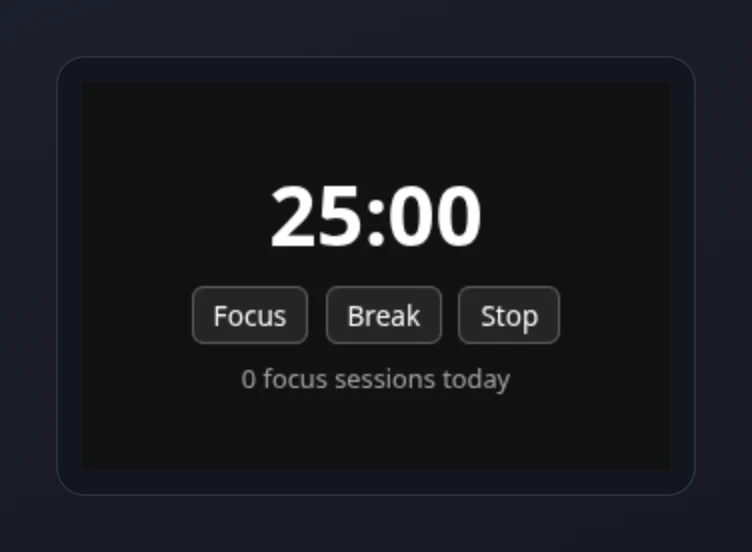<br><code>pomodoro.html</code></td></tr>
<tr><td align="center">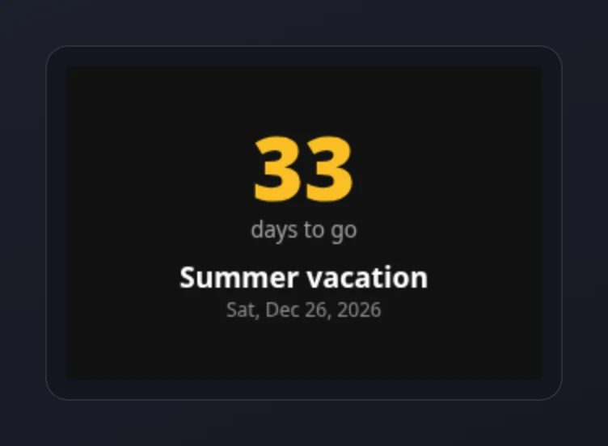<br><code>countdown.html</code></td><td align="center">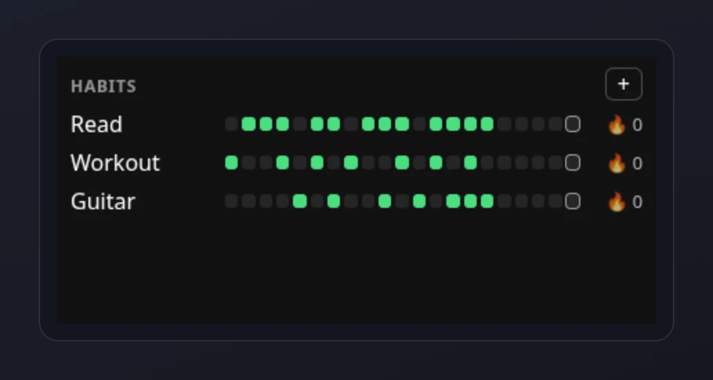<br><code>habit-tracker.html</code></td><td align="center">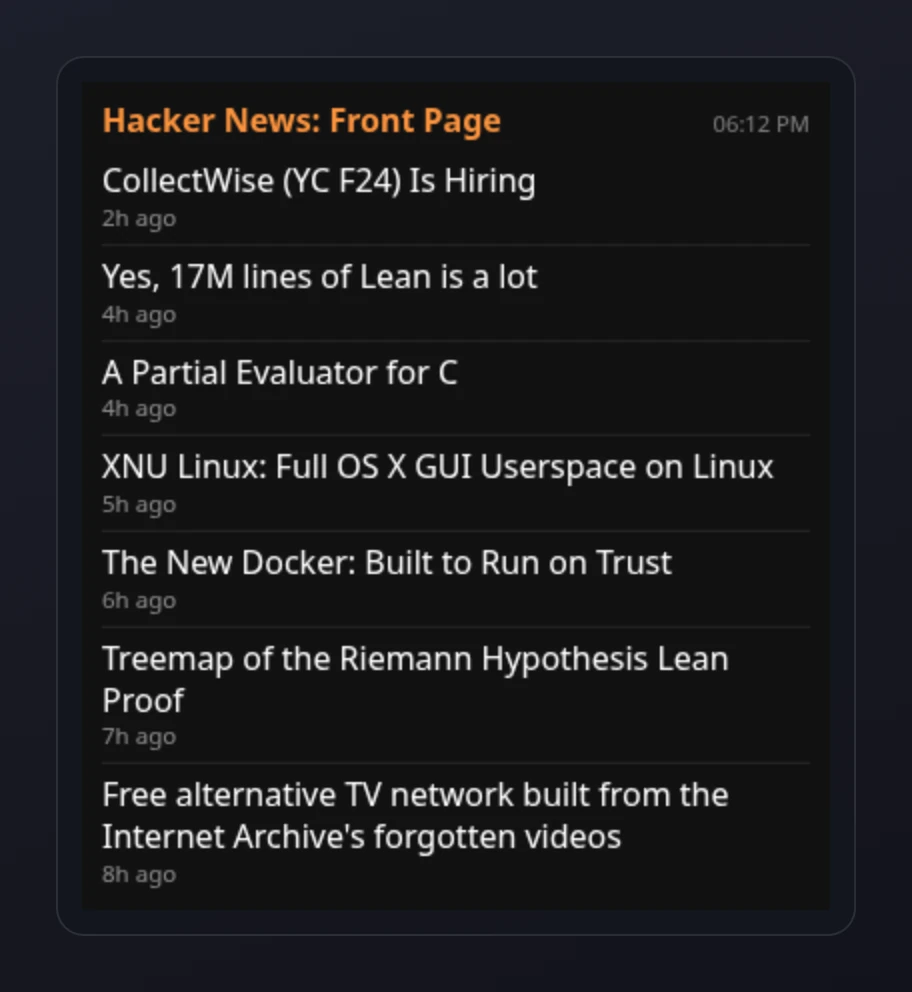<br><code>rss-reader.html</code></td></tr>
<tr><td align="center">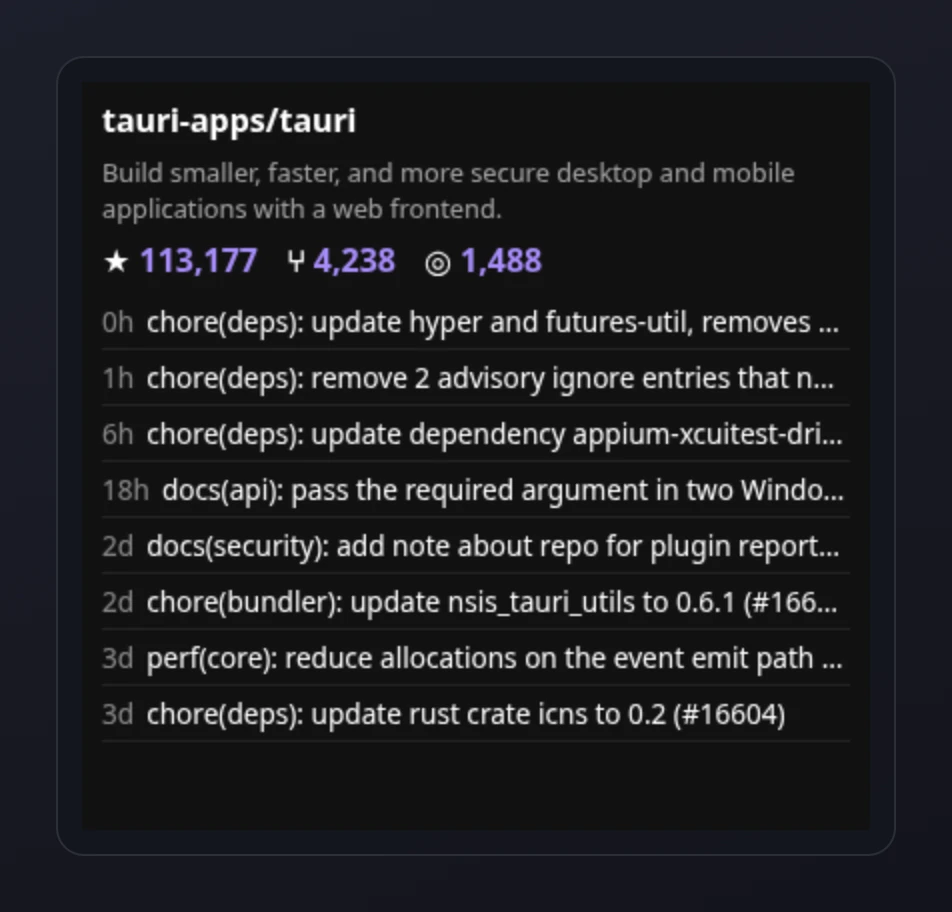<br><code>github-activity.html</code></td><td align="center">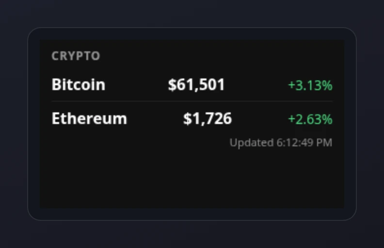<br><code>crypto-ticker.html</code></td><td align="center"><br><code>image-of-the-day.html</code></td></tr>
<tr><td align="center">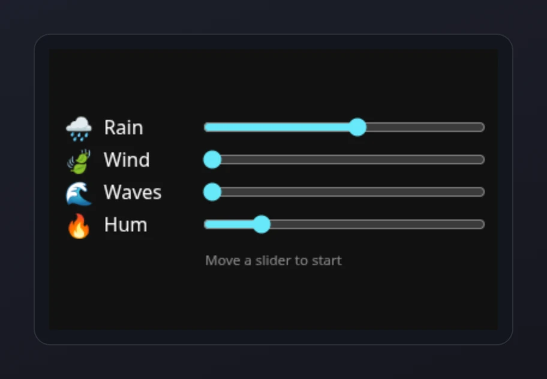<br><code>ambient-mixer.html</code></td><td align="center">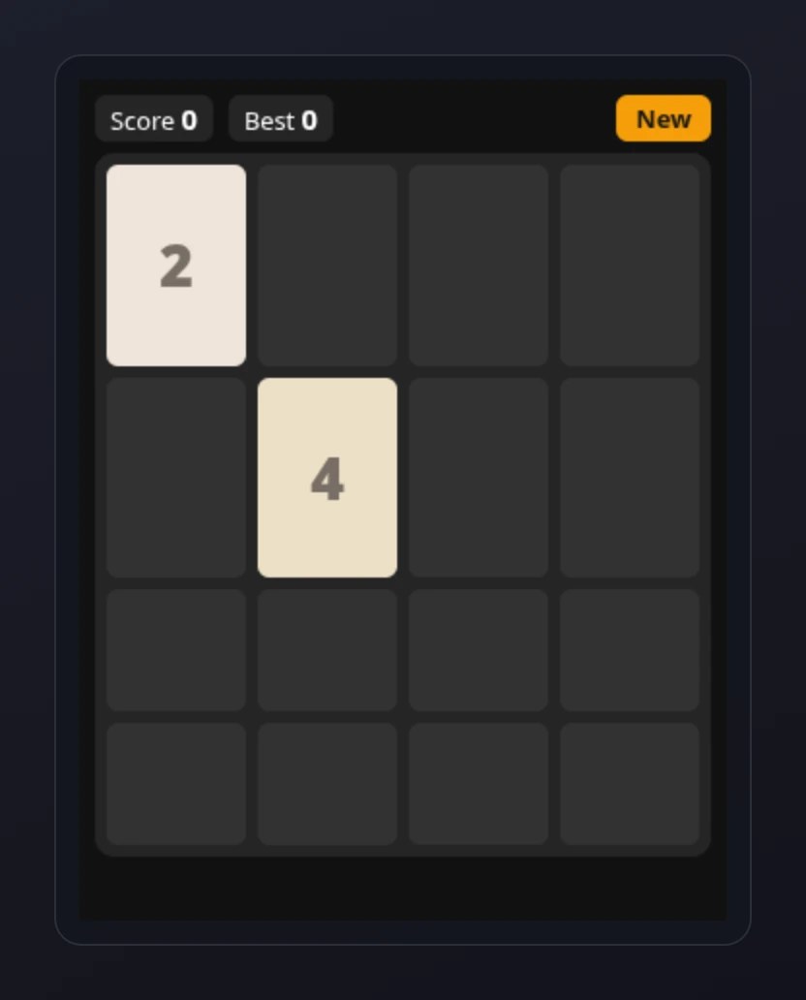<br><code>game-2048.html</code></td><td align="center">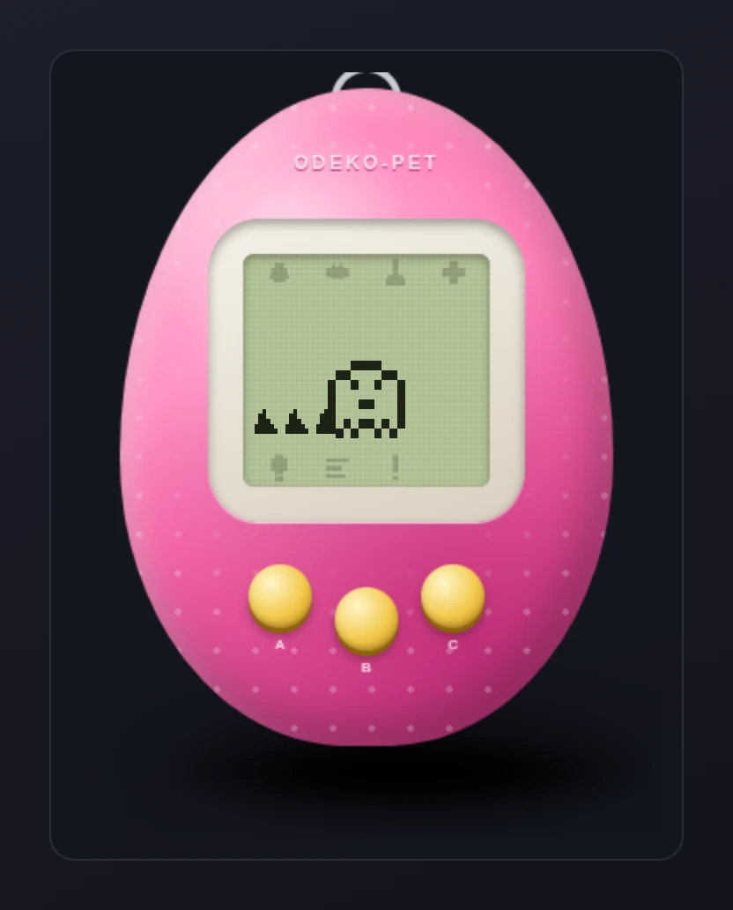<br><code>tamagotchi.html</code></td></tr>
</table>

## How it runs

- The page starts with a transparent background, white text and no margin,
  so it sits on the widget's own background. Override any of it in your
  `<style>`.
- **Run JavaScript** can be turned off per widget; the page then renders as
  static HTML/CSS. Widgets from an imported preset start with it off.
- `<script src="https://…">`, `import … from "https://…"` and import maps
  load libraries through a local cache: they download on first use and work
  offline afterwards.
- Links never navigate the widget: `http(s)` and `mailto` links open in your
  browser, `#fragment` links scroll the page.
- In edit mode the page is covered so you can drag and resize the widget.
- Direct `fetch` is blocked; use `odeko.fetch`.

## The `odeko` helper

### Saved data

```js
const count = (await odeko.storage.get('count')) ?? 0;
await odeko.storage.set('count', count + 1);
await odeko.storage.remove('count');
const keys = await odeko.storage.keys();
```

Values are anything JSON can hold. Each widget has its own storage (up to
1 MB), kept in `widget-data/<widget id>.json` in the app's config folder. It
stays on this computer: exported presets do not include it. It survives
reloads, restarts and preset switches, and is deleted once no preset contains
the widget anymore. **Network & Data → Clear saved data** empties it.

### Network

```js
const { status, body } = await odeko.fetch('https://api.example.com/data');
const data = JSON.parse(body);

// Other methods, headers and a body (objects are sent as JSON text)
await odeko.fetch('https://api.example.com/items', {
	method: 'POST',
	headers: { Authorization: 'Bearer …', 'Content-Type': 'application/json' },
	body: { name: 'x' }
});
```

- The first request to each host shows **Allow / Deny** on the widget. The
  choice applies app-wide; revoke hosts in **Network & Data**.
- Local and private addresses are blocked unless you turn on **Allow local
  network** there.
- Check `status` and wrap parsing in `try/catch`, so a bad host or a rate
  limit shows up instead of a silent hang.
- Methods: GET, POST, PUT, PATCH, DELETE, HEAD. `Host`, `Cookie`,
  `Content-Length` and other transport headers cannot be set. Bodies are up
  to 1 MB of text.
- An API key in a header is saved with the widget's HTML or storage, and an
  exported preset carries the HTML. Keep keys out of widgets you share.

### Hidden canvas

```js
odeko.on('pause', () => {}); // the canvas was hidden: stop timers, animation, sound
odeko.on('resume', () => {}); // it is shown again
odeko.paused; // true while hidden
```

The canvas spends most of its time hidden, and a widget keeps running there.
Stop anything that costs CPU or makes sound on `pause`.

### Other

```js
odeko.open('https://example.com'); // open a URL in the browser
odeko.kind; // "widget"
```

## Styling the frame

The page is its own document, so put its styles in its `<style>` block.
The widget's **Appearance** tab and Custom CSS style the frame around it
(`.custom-widget`, `.html-frame`), e.g. a gradient border or a shadow.

## Prompts and dialogs

The page is sandboxed: `alert`, `confirm` and `prompt` do nothing. Edit
values in the page itself (an input that appears on click), as
`habit-tracker.html` and `rss-reader.html` do.

## Generating one with an LLM

Paste this README into the chat and describe the widget. The AI chat widget
can also write one for you directly.
