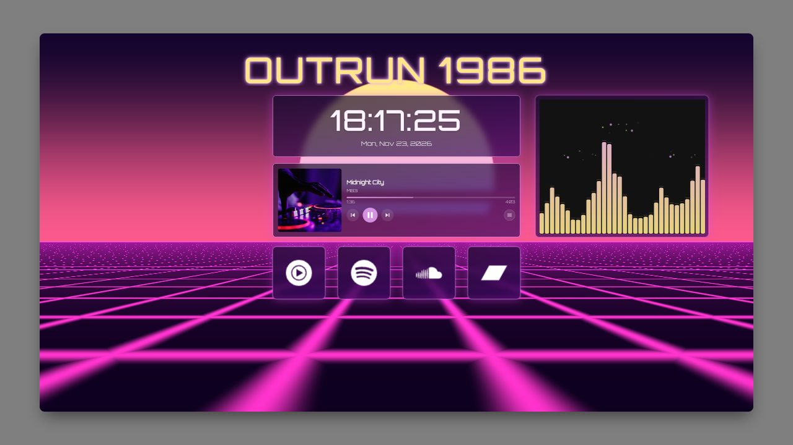
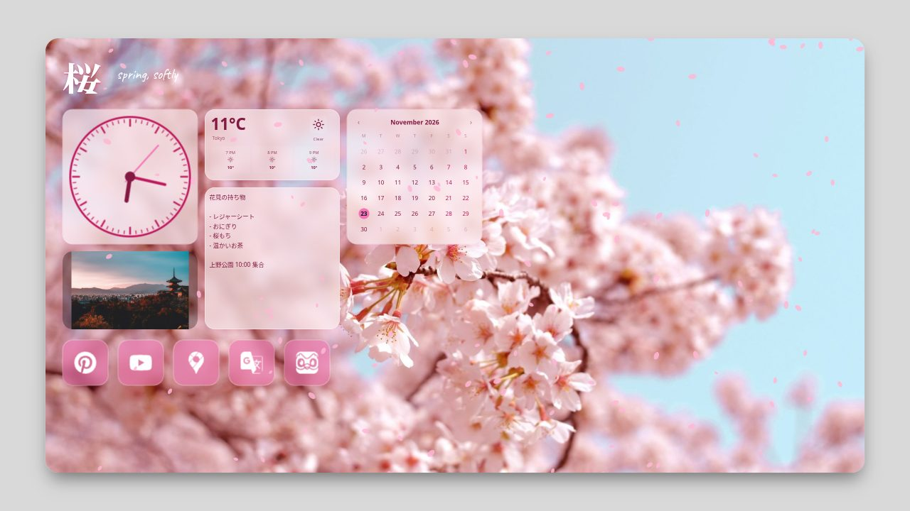

# Preset examples

Whole canvases, ready to import: background, widgets, links, custom CSS and
HTML, all in one file. Import one to see how the pieces from the other example
folders fit together, then take it apart.

## How to install

Download a file, then Settings → **Presets** → **Import**, and click the new
preset to switch to it. Your own presets stay as they are.

- The layouts are made for a 2560×1440 screen. On a smaller one, enter edit
  mode (F2) and drag things into place.
- Custom HTML widgets and HTML backgrounds arrive with **Run JavaScript** off.
  Turn it on in each one's settings to bring them to life.
- Memo and task list contents are not part of a preset, so those start empty.
- Images and link icons load from this repository's `assets/` folder over the
  internet.

## Feature tours

Each one shows one part of Odeko.

| File                          | Shows                                                                        |
| ----------------------------- | ---------------------------------------------------------------------------- |
| `Daily Desk.json`             | The everyday canvas: clock, weather, music, notes, tasks, links, a slideshow |
| `Live Wallpaper.json`         | A shader background that reacts to the pointer and icons                     |
| `Interactive Background.json` | HTML backgrounds: click to plant flowers, snow settling on the icons         |
| `Command Center.json`         | A canvas built only from Custom HTML widgets                                 |
| `Style Lab.json`              | Every widget restyled with the themes from [custom-css](../custom-css)       |

<table>
<tr><td align="center"> <code>Daily Desk.json</code></td><td align="center"> <code>Live Wallpaper.json</code></td></tr>
<tr><td align="center"> <code>Interactive Background.json</code></td><td align="center"> <code>Command Center.json</code></td></tr>
<tr><td align="center"> <code>Style Lab.json</code></td></tr>
</table>

## Themes

Complete looks to use as they are.

| File                    | Look                                                             |
| ----------------------- | ---------------------------------------------------------------- |
| `Synthwave.json`        | Neon sunset grid shader, music and a visualizer                  |
| `Cozy Cafe.json`        | Warm café photo, soft brown panels, a focus timer                |
| `Sakura.json`           | Cherry blossoms with petals falling over the icons, pink widgets |
| `Retro Arcade.json`     | Pixel fonts, CRT shader, fireworks on click, 2048                |
| `Terminal Hacker.json`  | Matrix rain, a terminal and green monospace panels               |
| `Minimal Mono.json`     | Just a big clock and five links on paper white                   |
| `ASCII Tokyo Rain.json` | A rainy city drawn in ASCII by a shader                          |

<table>
<tr><td align="center"> <code>Synthwave.json</code></td><td align="center"> <code>Cozy Cafe.json</code></td></tr>
<tr><td align="center"> <code>Sakura.json</code></td><td align="center"> <code>Retro Arcade.json</code></td></tr>
<tr><td align="center"> <code>Terminal Hacker.json</code></td><td align="center"> <code>Minimal Mono.json</code></td></tr>
<tr><td align="center"> <code>ASCII Tokyo Rain.json</code></td></tr>
</table>

## Fonts

Some themes use free Google Fonts. Without them the text falls back to the
system font. To get the intended look, download the font and add it from any
font picker with **Add font file…**.

| Font                                                               | Used by                           |
| ------------------------------------------------------------------ | --------------------------------- |
| [Space Grotesk](https://fonts.google.com/specimen/Space+Grotesk)   | Live Wallpaper, Minimal Mono      |
| [Fraunces](https://fonts.google.com/specimen/Fraunces)             | Interactive Background, Cozy Cafe |
| [Monoton](https://fonts.google.com/specimen/Monoton)               | Style Lab                         |
| [Orbitron](https://fonts.google.com/specimen/Orbitron)             | Synthwave                         |
| [Caveat](https://fonts.google.com/specimen/Caveat)                 | Sakura                            |
| [Press Start 2P](https://fonts.google.com/specimen/Press+Start+2P) | Retro Arcade                      |
| [VT323](https://fonts.google.com/specimen/VT323)                   | Retro Arcade, Terminal Hacker     |
| [IBM Plex Mono](https://fonts.google.com/specimen/IBM+Plex+Mono)   | ASCII Tokyo Rain                  |

## Writing your own

Build the canvas in the app and use **Export** from the preset's menu. The
file is plain JSON, so it can also be edited by hand or by an LLM.
